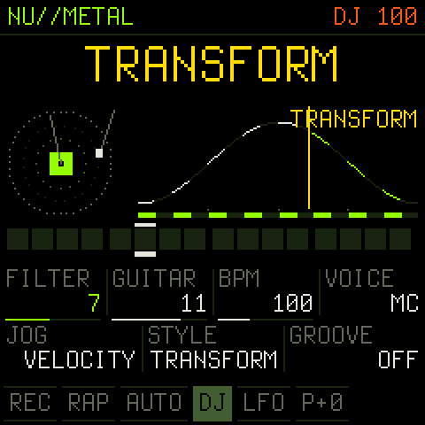
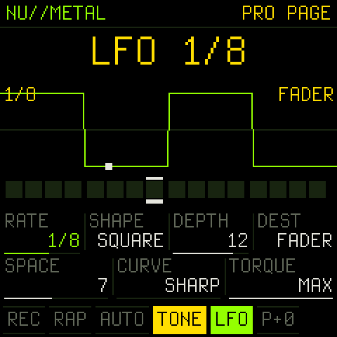
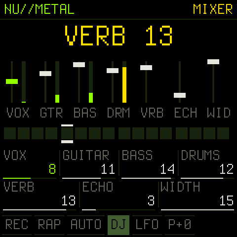

<p align="center"></p>

# NU//METAL SKRATCHMASTER PRO

**A robot turntablist with a nu metal band, for the M-VAVE FM-1. Version 2.0: the PRO edition.**

The FM-1 becomes a deck. SAM (the 1982 Software Automatic Mouth) says 27 words onto a virtual record, and you scratch
them with the keys and the jog wheel. Behind you a drop-tuned band plays: double-tracked chugging guitars, a bass and
a 12-piece kit locked to ten grooves. In **RAP MODE** the robot is the MC: four bars of verse, where it raps rhyming
lines that fit the beat, then four bars of hook, where the guitars come in and it shouts the hook in a Melvins-style
**GROWL**.

PRO adds what a turntablist expects from a real setup:

- **A real LFO**, locked to the tempo (and to MIDI clock), with 7 shapes and 6 destinations, the deck's pitch and the
  record itself among them
- **17 scratch techniques**, each one scored the way TTM notation writes a scratch (the record's motion plus the
  crossfader's clicks), and **COMBO** routines that string them together
- **HAMSTER** switch, crossfader **CURVE**, turntable motor **TORQUE**
- **TONE PLAY**: the keys become a pitch fader, for melodies on a tone, on AHHH or on any word
- **AHHH** and **FRESH**, the two classic battle-record sounds
- **A bigger sound engine**: a vocal chain, double-tracked guitars, a stereo plate reverb, a glue compressor and a
  soft limiter
- **A MIXER page** with faders and live meters

<p align="center">



</p>

<p align="center"></p>

> **Status: 2.0, runs on the FM-1.** Identity `FM-1_926`, the same as NU//METAL SKRATCHMASTER 1.0: it installs over it.
> Installing firmware is at your own risk; M-VAVE's official firmware can be reinstalled at any time.

## Install

- **In the browser:** open the **[web installer](https://mhellar.github.io/numetal-skratchmaster-pro-fm1/)** in Chrome
  or Edge on a computer, plug the FM-1 in with a USB data cable, press **Install**. It uses Web MIDI, and nothing
  else needs to be installed.
- **From the command line:** download `numetal-pro-2.0.fwsc` from [Releases](../../releases) (or
  [docs/firmware](docs/firmware)), then `python3 tools/fm1_install.py numetal-pro-2.0.fwsc`
  (needs `pip3 install mido python-rtmidi`).
- **Rescue:** hold **OCT-** while switching on. No sound, only the updater. Install anything from there.

The first start of 2.0 sets everything to defaults: the saved settings grew.

## Play

Press **PLAY**, then press **ARP** for RAP MODE. Tap a key: the robot says the word. Hold it: the word is scratched
in time, in the STYLE. Turn **SELECT** to scratch by hand; flick it and let go, and the record spins on.

Three buttons open a page while you hold them, and the knobs change meaning while they are held: **EDIT** (the
second layer, and the audio load), **LFO** (the PRO page) and **FX** (the MIXER). A quick tap still does what the
button always did.

| Key / button | Tap / hold | With **EDIT** held |
| --- | --- | --- |
| **Keys** | DJ mode: 27 words (25 = AHHH, 26 = FRESH); tap = say it, hold = a tempo-synced scratch in the STYLE (in RAP MODE the last word you tap becomes the hook). BEAT mode: keys 1-12 = the kit (hold = roll), 13-27 = the first 15 words. TONE mode: the keys are a pitch fader (see TONE PLAY) | |
| **PLAY** | start / stop | TAP tempo |
| **REC** | record into the 16 steps (quantized) | clear the words, keep the drums |
| **SEQ** | hold = FILL (snare roll, chugs, toms) | clear the steps |
| **ARP** | RAP MODE: verse / hook, the robot MCs | MUTATE the steps |
| **GLO** | AUTO: the robot scratches by itself | HARD: drums driven, the kick ducks the deck |
| **FX** | tap = next FX, hold = the MIXER | previous FX |
| **SEL** | hold = DROP (only the hats, then slam back in) | HAMSTER on / off |
| **ENV** | hold = FREEZE (loop a sliver) | latch FREEZE |
| **LFO** | tap = LFO on / off, hold = the PRO page | hold = CUT (the crossfader on 32nds) |
| **HOME** | DJ / BEAT / TONE | pitch back to 0 |
| **OCT- / OCT+** | the deck's pitch, a semitone | BACKSPIN / BRAKE |
| **SAVE** | save everything now | SYNC: FOLLOW / OFF |

| Encoder | Turn | **EDIT** held | **LFO** held: the PRO page | **FX** held: the MIXER |
| --- | --- | --- | --- | --- |
| **SELECT** | JOG: scratch by hand (velocity) | VELOCITY FX: the flick pumps the FX | SPACE (the plate) | VERB |
| **ALGORITHM** | STYLE (TONE mode: SOURCE) | SWING | fader CURVE | ECHO |
| **KNOB1** | the FX's amount | TUNING: drop F .. drop F (B = 7-string) | LFO RATE | VOX |
| **KNOB2** | GUITAR level | ECHO | LFO SHAPE | GUITAR |
| **KNOB3** | BPM 60..180 | KIT DECAY | LFO DEPTH | BASS |
| **KNOB4** | SAM VOICE: MC GROWL ROBOT SAM ELF E.T. STUFFY OLD LADY | DRUMS level | LFO DEST | DRUMS |
| **PRESETS** | GROOVE: OFF BOUNCE B-BOY JUMP BREAKDOWN RAP METAL BOOM BAP STOMP TRAP SLUDGE | REACH | motor TORQUE | WIDTH |

**FX:** FILTER, CRUSH, MEGAPHONE, DEMON, CRUNCH, STUTTER, REVERSE, WAH, GROWL.

### The techniques

BABY, DRAG, STAB, FORWARD, BACKWARD, CHIRP, TRANSFORM, TEAR, FLARE (1-click), 2-CLICK flare, ORBIT, CRAB, TWIDDLE,
TAZER, SCRIBBLE, HYDROPLANE, LASER, and COMBO.

Each technique is a score: key points for the record's motion (eased like a hand, linear, or accelerating) and the
stretches where the crossfader is open, 64 ticks a beat, locked to the tempo. Hold a key and the word is scratched
with it; while it plays, the screen draws the score with a playhead running over it. Turn STYLE while holding: the
next loop plays the new technique. **COMBO** plays routines, a technique a beat in phrases of four that end on a
flourish (AUTO plays whole routines).

**HAMSTER** reverses the fader in the techniques that click: a chirp keeps only the peaks, and a crab cuts out
instead of in. **CURVE** is the crossfader's cut: SHARP like a battle mixer, MEDIUM, SMOOTH. **TORQUE** is the motor:
LOW winds up like a stock turntable when a word starts, MAX starts at once. It also sets how fast a thrown record
settles and how long a BRAKE takes. Fast scratches are anti-aliased (the deck averages what it skips), so a hard tear
stays clean.

### The LFO

Tap **LFO** to switch it on; its button pulses with it. Hold **LFO** for the PRO page:

- **RATE** 4 BAR, 2 BAR, 1 BAR, 1/2, 1/4, 1/4T, 1/8, 1/8T, 1/16, 1/16T, 1/32
- **SHAPE** SINE, TRI, SAW UP, SAW DN, SQUARE, S&H, DRIFT (a gliding S&H)
- **DEPTH** 0..15
- **DEST**
  - **FX** sweeps the current FX (FILTER and WAH glide smoothly)
  - **PITCH** from vibrato to a +-12 semitone siren
  - **FADER** a tremolo; on SQUARE it is a transformer at the rate
  - **PAN** moves the deck between left and right
  - **RECORD** the LFO's hand on the record: deep, it rocks it back and forth, a baby scratch at the rate
  - **BAND** sweeps a low-pass over the guitars and the bass

The LFO's phase is the song's position, so it sits on the grid, follows MIDI clock and restarts with PLAY.

### TONE PLAY

Press **HOME** until TONE. The keys are now a pitch fader: chromatic, with key 13 on the root of the band's tuning,
so you play in key. Hold a key and the record runs at that pitch with the fader open; let go and the fader shuts.
**ALGORITHM** picks the SOURCE: TONE (a sine), BUZZ (a saw), AHHH, FRESH, YEAH, SCREAM, or the LAST WORD you said in
DJ mode. The LFO on PITCH gives vibrato, and the LFO on FADER with SQUARE gives transformed tones.

### The sound

- **Vocals:** the post chain filters the 8-bit record's fizz, adds body under 250 Hz, then a fast compressor puts
  the voice in front. An exciter adds air, and a doubler makes it wide while staying mono-safe (the copy sits only in
  the side).
- **Guitars:** double-tracked, two takes hard left and right. The second take is a few cents off and a few
  milliseconds late.
- **Space:** a stereo plate reverb holds the vocals, snare, claps, toms and the echo, and the RAP hook gets a reverb
  throw.
- **Master:** the bus runs into a glue compressor and a soft limiter, never a hard clip.
- **Load:** hold EDIT to see the audio load; about 30 % with everything going.

### The MIXER

Hold **FX** and turn: VOX, GUITAR, BASS, DRUMS, VERB, ECHO and WIDTH (0 = mono: the guitars, the doubler and the
plate all in the middle). The screen shows seven fader strips with live meters.

### Velocity skratch

The keys have no velocity, so it is read from how fast you move. Flick the jog faster and each click throws the
record further. Tap the same word again quickly for finger strokes, back and forth. With EDIT held the same moves
pump the current FX instead, like a wah pedal.

### MIDI

USB-MIDI channel 10, notes 36-47 = the kit; other channels, notes 48-74 = the 27 words. **SYNC FOLLOW** follows an
incoming clock (USB or the TRS input), and Start / Stop / Continue drive PLAY. Send **CC 119** and it answers with
CC 119 = the audio load in %.

## Build it

You need Linux on x86-64 (or macOS with Docker, or Windows with WSL), Python 3 with Pillow, the JieLi toolchain
and three files of the JieLi AC79 SDK:

```sh
pip3 install Pillow mido python-rtmidi
tools/get_toolchain.sh                      # JieLi's clang for the chip, to ~/.jieli/toolchain
git clone --depth 1 --branch AC79NN_SDK_V1.2.1_2023-12-13 \
    https://gitee.com/Jieli-Tech/fw-AC79_AIoT_SDK.git ~/fw-AC79_AIoT_SDK

tests/run_host.sh                           # on your computer: build/host/dinghy.wav + screen PNGs
tests/run_pro.sh                            # the PRO scripts: techniques, tone play + LFO, the mixer (WAV + frames)
./build.sh                                  # -> build/dinghy.fwsc
./build.sh --release 2.1                    # -> build/numetal-2.1.fwsc, "2.1" on the screen
python3 tools/fm1_install.py build/dinghy.fwsc
```

The whole app is [firmware/src/dinghy.c](firmware/src/dinghy.c). It is integer-only, because the chip has no FPU.
The platform under it is [Dinghy](https://github.com/zvenson/dinghy): [docs/API.md](docs/API.md) has every call, and
[docs/RULES.md](docs/RULES.md) has the chip's rules. The host build (`tests/host.c`) runs the same code on a computer.
Its scripts can press keys, hold buttons (`T hold MASK`) and turn encoders (`T enc ID DELTA`), and it prints the
audio code's cost per frame.

The web installer is [docs/index.html](docs/index.html), served by GitHub Pages from `docs/`. Put a new package in
`docs/firmware/` and change `FIRMWARE` at the top of the page's script.

## License

GPL-3.0-only, like everything it stands on: you may change and share it, and whoever gets the firmware gets its
source. Credits and third-party parts are in [LICENSING.md](LICENSING.md).

NU//METAL SKRATCHMASTER PRO (the app) by Mark Hellar. Built on
[Dinghy](https://github.com/zvenson/dinghy) (zvenson), on the platform of [Felucca](https://github.com/hugelton/Felucca)
(Leo Kuroshita, Hügelton Instruments) as [SLOOP](https://github.com/isod89/sloop-fm1) (isod89) carries it. The voice is
SAM via [ESP8266SAM](https://github.com/earlephilhower/ESP8266SAM) (Earle F. Philhower III), from Sebastian Macke's
C port of SAM. The web installer's update protocol (`docs/fm1ota.js`) is Felucca's, by Leo Kuroshita.
