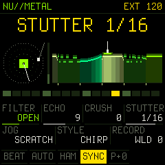
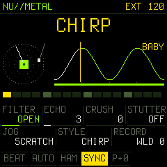
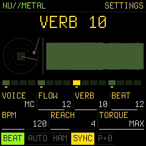
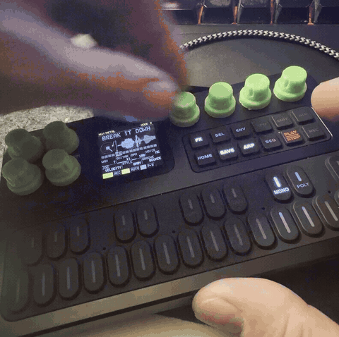

<p align="center"></p>

# NU//METAL SKRATCHMASTER PRO

**A scratch instrument for the M-VAVE FM-1. Version 4.0: SKRATCH. Jog. Tap. Cut.**

The FM-1 becomes one turntable. SAM (the 1982 Software Automatic Mouth) says 27 words onto a virtual record, or the
deck carries an endless record that is generated as you scratch it (a WORLD). Your left hand is on the jog, your right
hand taps and holds the keys, and the four knobs are four effects you can ride at once. It follows your drum machine's
MIDI clock, so it locks to the beat you are already playing.

4.0 is a cut-down. Everything that got in the way of scratching is gone: RAP MODE, the TONE and BEAT modes, the step
sequencer, the LFO page, the mixer, the 9-effect list and the band. What is left is the deck, the 17 techniques, the
endless record, four knob FX and a drum beat to practise over.

<p align="center">



</p>

<p align="center"></p>

> **Status: 4.0, runs on the FM-1.** Identity `FM-1_926`: it installs over NU//METAL 1.0 and PRO 2.x / 3.x.
> Installing firmware is at your own risk; M-VAVE's official firmware can be reinstalled at any time.
> Want the old one back? [3.1 TOYBOX](https://github.com/mhellar/numetal-skratchmaster-pro-fm1/blob/f805ef7/README.md)
> (RAP MODE, the sequencer, the LFO, the toys) is still in [docs/firmware](docs/firmware) as `numetal-pro-3.1.fwsc`.

## Install

- **In the browser:** open the **[web installer](https://mhellar.github.io/numetal-skratchmaster-pro-fm1/)** in Chrome
  or Edge on a computer, plug the FM-1 in with a USB data cable, press **Install**. It uses Web MIDI, and nothing
  else needs to be installed.
- **From the command line:** download `numetal-pro-4.0.fwsc` from [docs/firmware](docs/firmware), then
  `python3 tools/fm1_install.py numetal-pro-4.0.fwsc`
  (needs `pip3 install mido python-rtmidi`).
- **Rescue:** hold **OCT-** while switching on. No sound, only the updater. Install anything from there.

The saved settings changed shape in 4.0, so the first start sets everything to its defaults: the record on WORLD 0,
the filter open, ECHO 3, SYNC on FOLLOW, 120 BPM.

## Play

1. Switch on. The FM-1 says its name and the record is **WLD 0** (an endless WORLD).
2. **Tap a key** to drop the needle on one of 27 spots. **Hold a key** to scratch there in the technique that
   **ALGORITHM** picks. Tap the same key again quickly for finger strokes.
3. **Turn SELECT** to scratch by hand. Flick it and let go, and the record coasts on.
4. Ride **KNOB1-4**: FILTER, ECHO, CRUSH, STUTTER. Hold **FX** to drop them all at once (DRY).
5. Press **PLAY** for a drum beat to practise over, or plug in your drum machine's MIDI and it follows the clock.

| Encoder | Turn | **HOME** held + turn: SETTINGS |
| --- | --- | --- |
| **SELECT** | JOG: scratch by hand. The faster you flick, the further each click throws the record | BPM 60..180 (when no clock comes in) |
| **ALGORITHM** | TECHNIQUE: the 17 techniques and COMBO | REACH 1..8: how far a technique throws the record |
| **KNOB1** | FILTER: LP 7 .. OPEN .. HP 7, a resonant low-pass to the left, a high-pass to the right | SAM VOICE: MC, GROWL, ROBOT, SAM, ELF, E.T., STUFFY, OLD LADY |
| **KNOB2** | ECHO 0..15: a dotted-eighth echo locked to the tempo | FLOW 0..15 (WORLD records): 0 = separate sounds with gaps, 10+ = one continuous landscape |
| **KNOB3** | CRUSH 0..15: fewer bits and a lower sample rate | VERB 0..15: the plate reverb |
| **KNOB4** | STUTTER: OFF, 1/4, 1/8, 1/16, locked to the beat | BEAT 0..15: the practice drums' level (12 = normal) |
| **PRESETS** | RECORD: WORDS, or WORLD 0..99 | motor TORQUE: LOW, MID, HIGH, MAX |

| Button | Does |
| --- | --- |
| **Keys** | 27 spots on the record. Tap = drop the needle, tap again quickly = finger strokes, hold = the technique while held, locked to the beat |
| **PLAY** | the practice beat on / off |
| **FX** | hold = DRY: every FX off while held |
| **ENV** | hold = FREEZE: loop a sliver of the record |
| **LFO** | hold = CUT: the crossfader chops on 32nds |
| **REC** | BACKSPIN |
| **SEQ** | BRAKE: the turntable winds down (works under an external clock too: only the record stops) |
| **GLO** | AUTO: the robot scratches by itself. On a WORLD record it is ETERNAL SKRATCH: it rides the record forever |
| **SEL** | HAMSTER: flip the crossfader in the techniques that click |
| **ARP** | flip between WORDS and the last WORLD you used |
| **HOME** | hold + turn = SETTINGS; tap = pitch back to 0 |
| **OCT- / OCT+** | the deck's pitch, a semitone a press |
| **SAVE** | save now (settings also save themselves when the deck is quiet) |
| **EDIT + SAVE** | SYNC: FOLLOW an incoming MIDI clock / OFF |
| **EDIT** (hold) | shows the button map and the audio load |

The screen shows the record under the needle (the waveform of a word, or a WORLD scrolling by as a landscape), the
technique's score while you hold a key, a 16-step bar with the playhead (yellow when it follows an external clock,
green on its own BPM), the four FX, and chips for BEAT, AUTO, HAMSTER, SYNC and the pitch.

### Playing with a drum machine

Plug the drum machine's MIDI out into the FM-1's TRS input (or send clock over USB). With SYNC on FOLLOW (the
default), the top bar says **EXT** and the tempo; ECHO, STUTTER, CUT and the held techniques all lock to it.
Its **Start** puts the FM-1's bar back on the one, but it does not start the practice beat: your drum machine is the
beat. Stop and Continue are ignored. Run the FM-1's audio into the same mixer.

### The practice beat

**PLAY** starts a drum beat, drums only: a swung boom bap with the kick, the snare on 2 and 4 and eighth-note hats.
Most bars one small thing changes (a kick moves, a ghost snare, an open hat, a quick hat roll) and then drifts back.
Every 8th bar ends in a fill (a snare roll, toms, flams or a hat roll) and the next bar can land on a crash. Now and
then it moves on to a new pattern. Set its level with **HOME + KNOB4**.

### The records

**WORDS:** SAM says 27 words onto the record, one a key: a nu metal lexicon, the FM-1's name, and the battle-record
classics AHHH and FRESH. The voice is set with HOME + KNOB1.

**WORLD 0..99:** an endless record that is never stored. Every stretch is computed from where it is and from the
WORLD, so scratching back over a spot plays the same sound again, just like vinyl. The record is cut into zones of
0.74 s, each a sample on a battle record made from one of nine materials:

| Material | What it is |
| --- | --- |
| **AHHH** | a vowel built from FOF grains, gliding and morphing a to o |
| **CHIRP** | a tone sweeping octaves, or a LASER |
| **FM** | two operators: bells, screeches |
| **BYTE** | a bytebeat formula read at the record's speed: 8-bit shrapnel |
| **DUST** | the SAM words shattered into grains, some backwards |
| **CHAOS** | the logistic map swept through its bifurcations: a tone splits, then turns to noise |
| **HISS** | noise through a sweeping resonant filter |
| **STAB** | a horn / power-chord hit in drop A |
| **CUT** | a whole word off the bank (AHHH and FRESH most of all), pitched down |

Each WORLD leans on three materials. The keys are 27 spots, but the jog goes anywhere, far past them: flick it and the
record coasts through zone after zone. The screen draws each zone as a mountain in its material's green, the key spots
in yellow, and a little surfer riding the needle.

### The techniques

BABY, DRAG, STAB, FORWARD, BACKWARD, CHIRP, TRANSFORM, TEAR, FLARE (1-click), 2-CLICK flare, ORBIT, CRAB, TWIDDLE,
TAZER, SCRIBBLE, HYDROPLANE, LASER, and COMBO.

Each technique is a score: the record's motion and the stretches where the crossfader is open, 64 ticks a beat,
locked to the tempo. Hold a key and the record is scratched with it while the screen draws the score with a playhead.
Turn ALGORITHM while holding: the next loop plays the new technique. **COMBO** strings techniques into phrases of four
that end on a flourish. **HAMSTER** reverses the fader in the techniques that click. **TORQUE** is the motor: LOW
winds up like a stock turntable, MAX starts at once; it also sets how fast a thrown record settles and how long a
BRAKE takes. Fast scratches get darker the faster they go, so a hard tear stays fat instead of shrill.

### The sound

- **The deck:** the 8-bit record is filtered, given body under 250 Hz, compressed so it sits in front, and doubled
  wide (mono-safe: the copy sits only in the side).
- **The FX:** STUTTER re-cuts the record on the beat, FILTER and CRUSH shape it, ECHO throws it (and feeds the
  reverb).
- **The drums:** an 808 kit rendered offline as 16-bit samples, driven, and the kick ducks the deck a little.
- **Space:** a stereo plate reverb (VERB).
- **Master:** a glue compressor and a soft limiter, never a hard clip.

### MIDI

**In** (USB or the TRS jack): clock and Start (SYNC FOLLOW). Channel 10 plays the drum kit on the General MIDI map
(35 808, 36 kick, 37 rim, 38/40 snare, 39 clap, 42/44 hat, 46 open hat, toms, 49/55/57 crash, 52 china, 53 zap).
Other channels: notes 48-74 drop the needle on the 27 spots of the record that is on.
**Out** (USB): every drum played as a GM note on channel 10, and the deck on channel 1: CC 20 scratching (0/127),
CC 21 the crossfader, CC 22 the platter angle, sent on change. Send **CC 119** and it answers with CC 119 = the audio
load in %.

## Build it

You need Linux on x86-64 (or macOS with Docker, or Windows with WSL), Python 3 with Pillow, the JieLi toolchain
and three files of the JieLi AC79 SDK:

```sh
pip3 install Pillow mido python-rtmidi
tools/get_toolchain.sh                      # JieLi's clang for the chip, to ~/.jieli/toolchain
git clone --depth 1 --branch AC79NN_SDK_V1.2.1_2023-12-13 \
    https://gitee.com/Jieli-Tech/fw-AC79_AIoT_SDK.git ~/fw-AC79_AIoT_SDK

tests/run_v40.sh                            # on your computer: a jam with a clock, the beat, the deep cuts (WAV + screens)
./build.sh                                  # -> build/dinghy.fwsc
./build.sh --release 4.0                    # -> build/numetal-4.0.fwsc, "4.0" on the screen
python3 tools/fm1_install.py build/dinghy.fwsc
```

The whole app is [firmware/src/dinghy.c](firmware/src/dinghy.c). It is integer-only, because the chip has no FPU.
The platform under it is [Dinghy](https://github.com/zvenson/dinghy): [docs/API.md](docs/API.md) has every call, and
[docs/RULES.md](docs/RULES.md) has the chip's rules. The host build (`tests/host.c`) runs the same code on a computer.
Its scripts can press keys, hold buttons (`T hold MASK`), turn encoders (`T enc ID DELTA`) and send MIDI
(`T midi ST D1 D2`), and it prints the audio code's cost per frame. Many of the older test scripts in `tests/`
drive 3.x features that 4.0 removed. Why 4.0 cut what it cut: [PLAN_4.0.md](PLAN_4.0.md).

The web installer is [docs/index.html](docs/index.html), served by GitHub Pages from `docs/`. Put a new package in
`docs/firmware/` and change `FIRMWARE` at the top of the page's script.

## License

GPL-3.0-only, like everything it stands on: you may change and share it, and whoever gets the firmware gets its
source. Credits and third-party parts are in [LICENSING.md](LICENSING.md).

NU//METAL SKRATCHMASTER PRO (the app) by Mark Hellar. Built on
[Dinghy](https://github.com/zvenson/dinghy) (zvenson), on the platform of [Felucca](https://github.com/hugelton/Felucca)
(Leo Kuroshita, Hügelton Instruments) as [SLOOP](https://github.com/isod89/sloop-fm1) (isod89) carries it. The voice is
SAM via [ESP8266SAM](https://github.com/earlephilhower/ESP8266SAM) (Earle F. Philhower III), from Sebastian Macke's
C port of SAM. The web installer's update protocol (`docs/fm1ota.js`) is Felucca's, by Leo Kuroshita.
