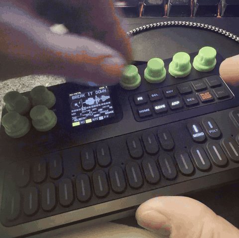
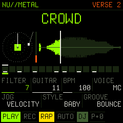

<p align="center"></p>

# NU//METAL SKRATCHMASTER

**For the M-VAVE FM-1.**

The FM-1 becomes a deck. SAM (the 1982 Software Automatic Mouth) says 27 words onto a virtual record, and you scratch
them with the keys and the jog wheel. Behind you a drop-tuned band plays: chugging guitars, a bass and a 12-piece kit
locked to ten grooves. In **RAP MODE** the robot is the MC: four bars of verse, where it raps rhyming lines that fit
the beat, then four bars of hook, where the guitars come in and it shouts the hook in a Melvins-style **GROWL**.

<p align="center"></p>

<p align="center"></p>

> **Status: 1.0, runs on the FM-1.** Built and played on the device. Identity `FM-1_926`.
> Installing firmware is at your own risk; M-VAVE's official firmware can be reinstalled at any time.

## Install

- Download `numetal-X.Y.fwsc` from [Releases](../../releases), then
  `python3 tools/fm1_install.py numetal-X.Y.fwsc` (needs `pip3 install mido python-rtmidi`).
- **Rescue:** hold **OCT-** while switching on. No sound, only the updater. Install anything from there.

## Play

Press **PLAY**, then press **ARP** for RAP MODE. Tap a key: the robot says the word. Hold it: the word is scratched
in time, in the STYLE. Turn **SELECT** to scratch by hand; flick it and let go, and the record spins on.

| Key / button | Tap / hold | With **EDIT** held |
| --- | --- | --- |
| **Keys** | DJ mode: 27 words, tap = say it, hold = tempo-synced scratch (in RAP MODE the last word you tap becomes the hook). BEAT mode: keys 1-12 = the kit (hold = roll), 13-27 = the first 15 words | |
| **PLAY** | start / stop | TAP tempo |
| **REC** | record into the 16 steps (quantized) | clear the words, keep the drums |
| **SEQ** | hold = FILL (snare roll, chugs, toms) | clear the steps |
| **ARP** | RAP MODE: verse / hook, the robot MCs | MUTATE the steps |
| **GLO** | AUTO: the robot scratches by itself | HARD: drums driven, the kick ducks the deck |
| **FX** | next FX | previous FX |
| **SEL** | hold = DROP (only the hats, then slam back in) | |
| **ENV** | hold = FREEZE (loop a sliver) | latch FREEZE |
| **LFO** | hold = CUT (crossfader on 32nds) | latch CUT |
| **HOME** | DJ / BEAT | pitch back to 0 |
| **OCT- / OCT+** | the deck's pitch, a semitone | BACKSPIN / BRAKE |
| **SAVE** | save everything now | SYNC: FOLLOW / OFF |

| Encoder | Turn | With **EDIT** held |
| --- | --- | --- |
| **SELECT** | JOG: scratch by hand (velocity) | VELOCITY FX: the flick pumps the FX |
| **ALGORITHM** | STYLE: BABY CHIRP TRANSFORM TEAR FLARE CRAB | SWING |
| **KNOB1** | the FX's amount | TUNING: drop F .. drop F (B = 7-string) |
| **KNOB2** | GUITAR level (0 = off) | ECHO |
| **KNOB3** | BPM 60..180 | KIT DECAY |
| **KNOB4** | SAM VOICE: MC GROWL ROBOT SAM ELF E.T. STUFFY OLD LADY | DRUMS level |
| **PRESETS** | GROOVE: OFF BOUNCE B-BOY JUMP BREAKDOWN RAP METAL BOOM BAP STOMP TRAP SLUDGE | REACH (how far a held-key scratch goes) |

**FX:** FILTER, CRUSH, MEGAPHONE, DEMON, CRUNCH, STUTTER, REVERSE, WAH, GROWL.

**Velocity skratch:** the keys have no velocity, so it is read from how fast you move. Flick the jog faster and each
click throws the record further. Tap the same word again quickly for finger strokes, back and forth. With EDIT held
the same moves pump the current FX instead, like a wah pedal.

**MIDI:** USB-MIDI channel 10, notes 36-47 = the kit; other channels, notes 48-74 = the 27 words. **SYNC FOLLOW**
follows an incoming clock (USB or the TRS input), and Start / Stop / Continue drive PLAY.

## Build it

You need Linux on x86-64 (or macOS with Docker, or Windows with WSL), Python 3 with Pillow, the JieLi toolchain
and three files of the JieLi AC79 SDK:

```sh
pip3 install Pillow mido python-rtmidi
tools/get_toolchain.sh                      # JieLi's clang for the chip, to ~/.jieli/toolchain
git clone --depth 1 --branch AC79NN_SDK_V1.2.1_2023-12-13 \
    https://gitee.com/Jieli-Tech/fw-AC79_AIoT_SDK.git ~/fw-AC79_AIoT_SDK

tests/run_host.sh                           # on your computer: build/host/dinghy.wav + screen PNGs
./build.sh                                  # -> build/dinghy.fwsc
./build.sh --release 1.1                    # -> build/numetal-1.1.fwsc, "1.1" on the screen
python3 tools/fm1_install.py build/dinghy.fwsc
```

The whole app is [firmware/src/dinghy.c](firmware/src/dinghy.c). It is integer-only, because the chip has no FPU.
The platform under it is [Dinghy](https://github.com/zvenson/dinghy): [docs/API.md](docs/API.md) has every call, and
[docs/RULES.md](docs/RULES.md) has the chip's rules.

## License

GPL-3.0-only, like everything it stands on: you may change and share it, and whoever gets the firmware gets its
source. Credits and third-party parts are in [LICENSING.md](LICENSING.md).

NU//METAL SKRATCHMASTER (the app) by Mark Hellar. Built on
[Dinghy](https://github.com/zvenson/dinghy) (zvenson), on the platform of [Felucca](https://github.com/hugelton/Felucca)
(Leo Kuroshita, Hügelton Instruments) as [SLOOP](https://github.com/isod89/sloop-fm1) (isod89) carries it. The voice is
SAM via [ESP8266SAM](https://github.com/earlephilhower/ESP8266SAM) (Earle F. Philhower III), from Sebastian Macke's
C port of SAM.
